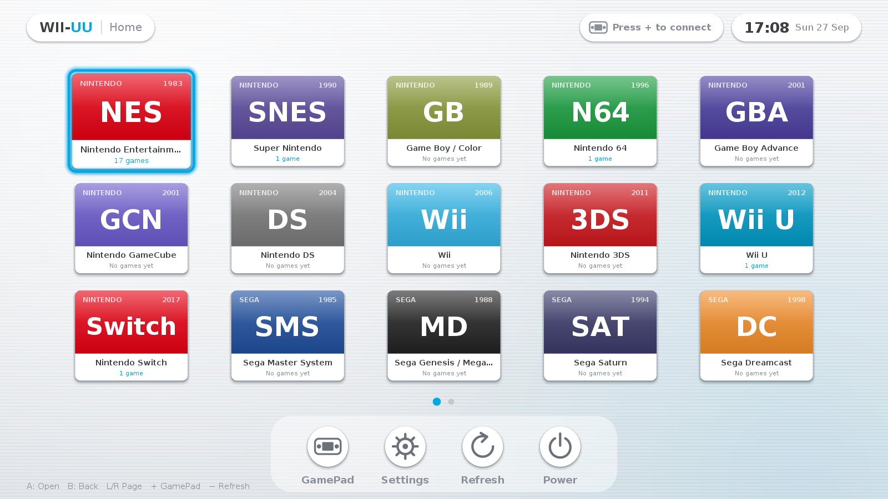
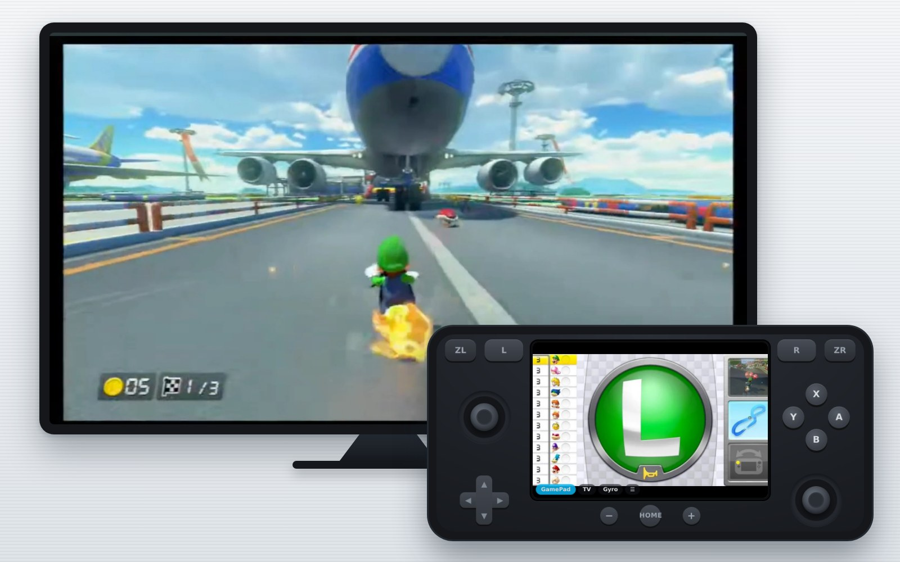
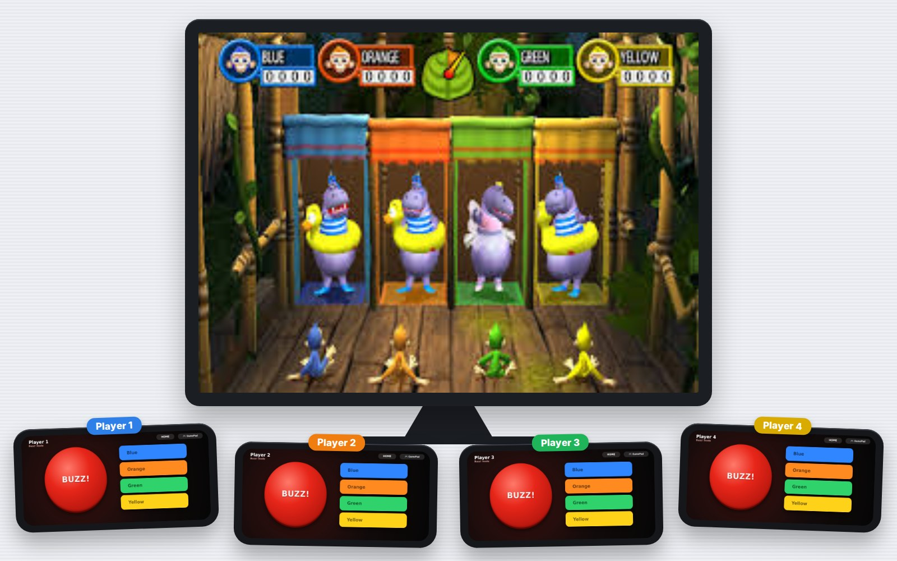
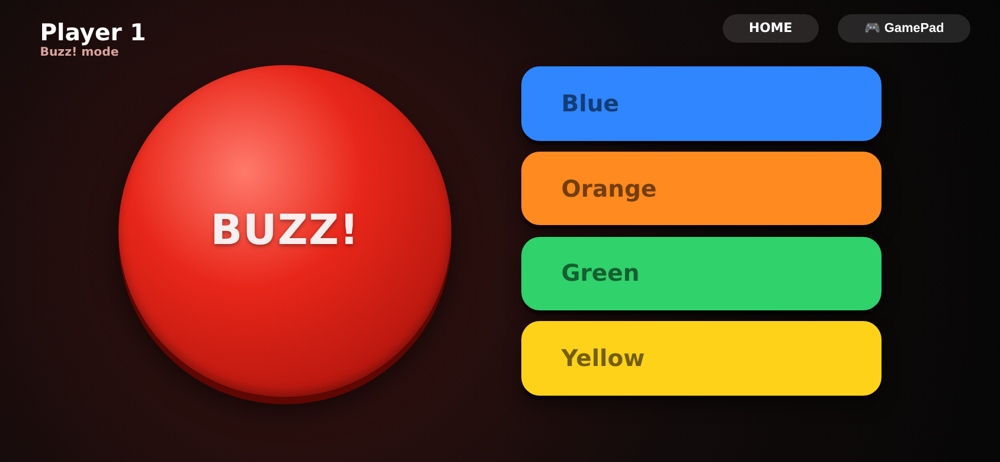
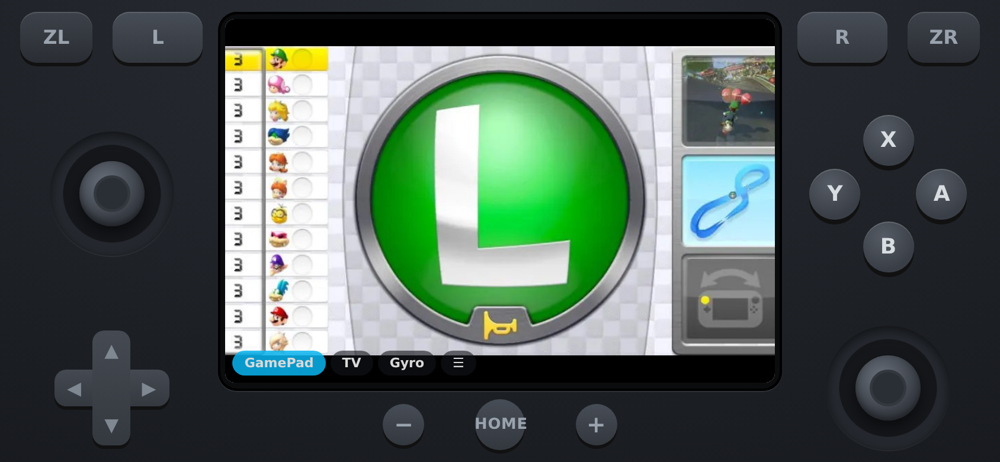

# WII-UU

A Wii U Menu–style emulator frontend written in Java, with a built-in web server that turns
any phone into a Wii U–like GamePad. The GamePad has buttons and sticks, a live touch screen
(Wii U GamePad view, DS/3DS bottom screen, or the whole TV), gyro, and the PC's sound. There are
no dependencies beyond Java 17+.

Website: **https://wiiuu.stoppedwumm.net** (served from `docs/`). It has a one-line install for
Linux, Raspberry Pi and macOS: `curl -fsSL https://wiiuu.stoppedwumm.net/get.sh | bash`.




It covers consoles from the NES to the Wii U and Switch, and Sony up to the PS4:

| Nintendo | Sega | Sony |
|---|---|---|
| NES, SNES, Game Boy/Color, N64, GBA, GameCube, DS, Wii, 3DS, **Wii U**, **Switch** | Master System, Genesis/Mega Drive, Saturn, Dreamcast | PS1, PS2, PSP, PS3, **PS4** |

WII-UU is a **launcher**: it finds your games, shows them in the Wii U–style UI and starts
the right emulator for each one. Each emulator (Mesen, Snes9x, Mupen64Plus, Dolphin, Cemu,
Ryujinx, DuckStation, PCSX2, PPSSPP, RPCS3, shadPS4 …) is installed separately. You also need
your own legally dumped games and, where an emulator requires it, your own firmware or keys.

## Install

Download [`WII-UU-latest.zip`](https://wiiuu.stoppedwumm.net/download/WII-UU-latest.zip), unzip
it, then:

* **Linux / macOS:** `./install.sh`
  (on Linux, `./install.sh --with-emulators` also installs the emulators, from official releases or source, and
  configures them for you; see below.)
* **Windows:** double-click `install.bat`

The installer:

* checks for Java 17+ and offers to install it (apt, dnf, pacman, zypper, Homebrew or winget)
* installs the app and adds a `wiiuu` command plus a menu, Start-menu or Desktop shortcut
* creates `~/WiiUU/roms/<system>` folders
* on Windows it adds a firewall rule when run as administrator; on Linux it prints the `ufw` or
  `firewalld` command to run
* **Linux:** offers the GamePad extras: `ffmpeg` (screen), `x11-utils` (finding windows), `python3`
  and `uinput` (virtual controllers), and `pulseaudio-utils` (sound)
* **macOS:** builds a native `WII-UU.app`, and offers Apple's Command Line Tools. WII-UU needs
  them to compile its screen and sound helpers.

To uninstall, run `./install.sh --uninstall` or `install.ps1 -Uninstall`. Your ROMs and settings are kept.

## Console Mode (Linux, Raspberry Pi)

Console Mode turns a PC or Raspberry Pi into a WII-UU console, the way SteamOS does on a Steam
Deck. The computer boots straight into WII-UU, full screen, with no desktop around it.

```sh
curl -fsSL https://wiiuu.stoppedwumm.net/get.sh | bash -s -- --console-mode   # new install
sudo wiiuu-console install                                                    # WII-UU already installed
```

* **Power → Desktop Mode** logs you into your normal desktop. The **Return to WII-UU** icon on the
  desktop, or in the app menu, goes back.
* **Power** also offers Restart and Shut Down, so a keyboard is never needed.
* **Controllers:** besides the phones, plug in any USB or Bluetooth controller and play (on
  Linux). Each one becomes a player like a phone: it gets the next free player number (*Settings →
  GamePad & players → Player order* shows it by name, and you can reorder phones and controllers
  together), and in games it plays through that player's virtual Xbox 360 controller, the one every
  emulator is already set up for, so no emulator needs setting up for it. WII-UU takes the controller
  over while it runs (only it reads it, so a game never sees it twice or as the wrong player);
  quitting WII-UU gives it back. Buttons go by position: the bottom one is B and the right one A,
  as on the GamePad. In the menu the stick or d-pad moves, the bottom button opens and the right one
  goes back (`input.padConfirm=east` swaps them, Nintendo style), the shoulders and triggers turn
  the page, Start shows the GamePad info and Select refreshes. *Controllers are players* off
  (`input.controllersAsPlayers=false`) leaves controllers to the emulators again (they then only
  steer the menu here; `input.localPads=false` turns that off too). This needs the virtual
  controllers (`install.sh` sets them up); without them, controllers steer the menu and each
  emulator reads them itself. On macOS and Windows the emulators read controllers themselves.
* **Remapping a controller:** *Settings → GamePad & players → Controller buttons* lists the
  controllers plugged in. Pick one, then a GamePad button (A, B, X, Y, L, R, ZL, ZR, +, −, HOME,
  L3, R3, the d-pad) and press the controller's button that should be it. The button that was it
  takes over the pressed one's old job (they swap), so nothing gets lost; extra buttons such as
  back paddles can be added as one more A, HOME... *Back to the standard layout* undoes it all.
  The layout applies everywhere the controller plays: the menu, Choccy Milk, every emulator, and
  on another WII-UU it's sent to. Controllers of the same kind (same name) share it
  (`remap.<name>=B=A,A=B,K2C0=HOME` in the config). Once A or B are remapped, they mean what you
  chose in the menu too. It works for controllers that are players of their own (see above).
* **Every boot** starts in console mode again, like on a Steam Deck.
* **If WII-UU crashes,** it is started again. If it fails three times in a row, the computer switches
  to the desktop, so you can never get locked out.
* **Updates** from *Settings → System → Check for updates* install in place, and WII-UU comes back by itself.

How it works:
* A login session called *WII-UU (Console Mode)* runs `wiiuu-session`, which keeps WII-UU running
  full screen under a minimal Openbox window manager. It also hides the mouse pointer and keeps the
  TV from blanking.
* The display manager logs you in automatically, to that session or to the desktop. LightDM (as on
  Raspberry Pi OS), SDDM (KDE) and GDM (GNOME) are supported. The installer adds LightDM if none is
  installed.
* The installer adds Xorg, Openbox and unclutter if they are missing.
* Switching uses a sudo rule that allows only `wiiuu-console switch desktop|console`.

```sh
wiiuu-console status                 # what's set up
wiiuu-console switch desktop         # switch now (the current session ends)
sudo wiiuu-console install --desktop plasma   # pick which desktop Desktop Mode opens
sudo wiiuu-console uninstall         # back to a normal desktop login
```

The session's log is in `$XDG_RUNTIME_DIR/wiiuu-session.log`.

## OpenBased videos

WII-UU can show the movies and episodes on an [OpenBased](https://github.com/Stoppedwumm/openbased)
media server as a channel on the home screen, and play them full screen on the TV, in Console Mode
as on a desktop.

1. **Once, on the OpenBased server:** add WII-UU as a client under `openbased.clients` in its
   `application.yml` (`/etc/openbased/application.yml` when installed as a systemd service) and restart
   it (`sudo systemctl restart openbased`). WII-UU shows the exact entry (*Settings → OpenBased*, or on the
   phone under *Server setup*); it looks like this, with your WII-UU's GamePad address:
   ```yaml
   - client-id: wiiuu
     name: WII-UU
     redirect-uris:
       - http://192.168.1.50:8080/openbased/callback
     grant-types: [authorization_code]
   ```
2. **Sign in:** on the phone (GamePad page → Library → **+ OpenBased**, handy in Console Mode, where
   there's no keyboard) or in *Settings → OpenBased*, enter the server address and press **Sign in
   with OpenBased**. OpenBased's own sign-in page opens; after you sign in it sends you back to WII-UU.
   Use the address that is OpenBased's `issuer`.

Signing in is OAuth 2 (Authorization Code with PKCE; WII-UU never sees your password). OpenBased only
gives such apps access tokens for 15 minutes and no refresh tokens, so WII-UU uses its sign-in once
to create its own personal access token in your account ("WII-UU (computer name)", valid a year,
scopes `media.read media.stream history.read history.write profile`). Signing in again replaces it,
and **Sign out** revokes it; it also shows on OpenBased's **API tokens** page, where you can revoke
it too. You can still paste a token you made yourself instead ("Use a token instead", which links to
that page): tick `media.read media.stream history.read history.write`, plus `profile` so Sign out
can revoke it, and choose 1 year. If the GamePad address changes, update the redirect URI in OpenBased (or set
`openbased.redirectUri` in WII-UU to a fixed name).

The **OpenBased** tile then comes first on the home screen, with your server's posters as covers and
what you started but didn't finish at the front. The phone's Library lists the videos too.

* **Player:** mpv if it is installed (Console Mode installs it), else VLC, else ffplay, or your own
  command in `openbased.player` (`{url}`, `{title}`, `{start}` in seconds).
* **Resume:** with mpv, a video starts where you stopped, and the position is saved to OpenBased every
  few seconds, so *continue watching* works across all your OpenBased apps.
* **GamePad:** A or + pause, left/right seek, up/down jump a minute, ZL/ZR volume, Y mute, X subtitles,
  L/R chapters. HOME → Close stops the video.
* **The token stays on this computer:** OpenBased never accepts personal tokens in links, so the
  player gets a link to a small proxy on `127.0.0.1` that adds the token (seeking works through it).
  The phone never sees the token.

## Installing emulators (Linux, Raspberry Pi)

`emulators.sh` (installed as `wiiuu-emulators`) sets up the emulators and points WII-UU's system
commands at them. It doesn't use Flatpak or containers.

* **Official releases first:** for each emulator it downloads the newest prebuilt Linux release
  for your CPU (x86-64 or 64-bit ARM such as a Raspberry Pi 4/5) from the project's GitHub or
  GitLab releases. The right file is chosen by name at install time, so new versions are picked
  up automatically. AppImages are unpacked, so they run without FUSE.
* **Source as fallback:** if a project publishes no Linux build for your CPU (for example
  Dolphin, or most ARM builds), the script compiles its latest source instead.

```sh
wiiuu-emulators              # releases where available; builds the light rest from source
wiiuu-emulators --all        # also build heavy emulators that have no release (e.g. Dolphin)
wiiuu-emulators --only ppsspp,duckstation
wiiuu-emulators --update     # update everything installed; skips what is already newest
wiiuu-emulators --list       # what is available / installed on this machine
wiiuu-emulators --nightly    # allow pre-release / rolling builds
wiiuu-emulators --source     # always build from source (bleeding edge)
wiiuu-emulators --releases-only
```

* **Emulators:**
  * With official releases: DuckStation, RPCS3, Ryujinx, Cemu, Azahar, melonDS, PPSSPP, Flycast,
    mGBA, Snes9x, FCEUX, and on x86-64 also PCSX2 and shadPS4. Whether an ARM64 build exists is
    up to each project.
  * Always built from source: Mupen64Plus, Mednafen and Dolphin, which publish no Linux binaries.
  * **Mupen64Plus** comes with the GLideN64 video plugin, which N64 games then use. On ARM boards
    (Raspberry Pi 4/5) everything is built for OpenGL ES, like RetroPie does: built for desktop
    OpenGL, the Pi only gets an old OpenGL 2.1 context and the game runs with sound but a black
    picture. `N64_GLES=1` or `N64_GLES=0` forces either kind of build.
  * **N64 controls (phones as virtual controllers):** WII-UU gives Mupen64Plus the phone layout:
    A and B as on the phone, ZL = Z, L and R (ZR too) = L and R, + = Start, the right stick = C
    buttons (X = C-up, Y = C-left as well), the left stick = the N64 stick. With a real controller
    plugged in, Mupen64Plus sets up the controllers itself. `mupen.padBinds=false` turns this off.
* **Build details:** source builds install their apt dependencies only when needed, and pick the
  number of parallel jobs from your RAM. Heavy builds can take hours on a Pi and need about 4 GB
  of swap on boards with under 6 GB of RAM.
* **Logs and files:** logs go to `~/.wiiuu/logs/build/<name>.log`. Emulators are kept in
  `~/.local/share/wiiuu-emulators`, and uninstalling WII-UU keeps them.
* **Rate limit:** GitHub allows 60 anonymous API requests per hour. Set `GITHUB_TOKEN` if you hit it.
* **Not supported:** PCSX2 (PS2) and shadPS4 (PS4) only run on x86-64.

## Use

**First start:** after the start-up animation, an eight-second intro cuts through the menu on a
beat (the home screen, your consoles' games, the GamePad screen, consoles flashing by, a tunnel of
tiles), then a setup guide walks through the basics on the TV, steered like the menu (phone,
controller, keyboard or mouse): the look (light, dark or automatic), menu music and sounds, the
phone as GamePad (scan the code, it shows when the phone connects), where games go (and RetroArch
mode), and controllers. Every choice applies straight away. *Settings → System → Show the setup
guide* brings it back any time, and *Restart into the setup guide* restarts WII-UU so it starts
with the guide, start-up animation and intro included, like the very first time. From a terminal,
`wiiuu --setup` does the same (`wiiuu --setup --no-intro` goes straight to the guide). The guide's
controller step is a live test: every button you press lights up on an on-screen GamePad. Any button skips
the intro; `ui.firstBootIntro=false` leaves it out.

WII-UU itself helps out in the guide: the little WII-UU card with googly eyes stands in the corner,
watches what you pick and talks you through each step out loud ("Light or dark? I look good in
both, honestly."). It reacts to your choices (turn the music off and it says "Ouch."), greets your
phone when it connects, and giggles when you try your controller. It only talks in the guide; the
voice is recorded ahead of time with [Piper](https://github.com/rhasspy/piper) (a voice trained on
the public-domain LJ Speech recordings), so nothing is downloaded, and the music ducks under it.
*Settings → System → WII-UU talks in the guide* (`ui.guideVoice=false`) keeps it quiet; its speech
bubble still shows.

It stays around after the guide, too: in the bottom-left corner of the menu it says hello by the
time of day, now and then has a word about the console, game or dock button you rest on ("No N64
games yet. Copy some into roms/n64"), reacts to the GamePad code and the power menu, welcomes you
back after a game, and says something when you click it. In Settings it stands under the
categories, with a line for each and a reaction when you flip a switch ("Ouch." for the music).
It only talks out loud in the setup guide. *Settings → Look & sound → WII-UU helper*
(`ui.mascot=false`) sends it away.

1. Copy games into `~/WiiUU/roms/<system>/`. The folder names are `nes snes gb n64 gba gc nds wii 3ds wiiu
   switch sms genesis saturn dc ps1 ps2 psp ps3 ps4`.
   * PS3 and PS4 games are folders. WII-UU finds the `EBOOT.BIN`/`eboot.bin` inside each one.
   * Wii U: `.wua`, `.wud`, `.wux`, or the `code/*.rpx` of an unpacked game.
   * Covers: put `covers/<game name>.png` (or `.jpg`) in a system folder, or place the image next to the ROM
     with the same name. PS3 `ICON0.PNG` and PS4 `sce_sys/icon0.png` are used automatically.
   * **Covers are found online** for games that have none: WII-UU looks them up in the
     [libretro thumbnails](https://thumbnails.libretro.com) collection (matched by the ROM's name,
     preferring USA / World / Europe releases and skipping betas and demos) and saves them as
     `covers/<game name>.png`. This happens by itself after each scan, or with *Settings → Games →
     Find covers online*, or `wiiuu --scrape` in a terminal. Covers you already have are never
     replaced. *Find covers by itself* (`scraper.auto=false`) turns the automatic search off.
     With a [ScreenScraper](https://www.screenscraper.fr) developer account (*Settings → Games →
     ScreenScraper account*, `scraper.ss.devid` / `scraper.ss.devpassword`, optionally your own
     `scraper.ss.user` / `scraper.ss.password`), WII-UU asks ScreenScraper first, which also knows
     games by checksum. Without one it uses libretro only.
2. Start WII-UU and open **Settings** (F1, or the dock). Under *Games → Consoles and emulators*,
   check each console's command, or use *Choose the emulator program* to pick it. In a command,
   `{rom}` is the game file, `{dir}` is its folder and `{name}` is its title.
3. Choose a system, then a game, and press Enter or A.

| Keyboard | GamePad | Action |
|---|---|---|
| Arrows / WASD | D-pad / left stick | Move |
| Enter / Space | A | Open / play |
| Esc / Backspace | B | Back |
| PgUp / PgDn, Q / E | L / R, ZL / ZR | Change page |
| F2 | + | Show the GamePad QR code |
| F5 | − | Rescan games |
| F1 | Settings in the dock | Settings |
| F11 | – | Toggle fullscreen |
| V | – | Full-screen music visualizer |
| Ctrl+Q | HOME → Close game | Quit the running game |

**Settings** are part of the menu on the TV, like a console's: categories on the left (Look &
sound, Games, GamePad & players, OpenBased, System), their settings on the right. Everything
works with the phone, a controller, the keyboard or the mouse: up / down to choose, ◀ ▶ to change
a choice or a switch, A to open or edit, B to go back, L / R for the next category, and the mouse
wheel (or just moving down) scrolls. Changes apply and are saved straight away. Text is typed on
an on-screen keyboard (A types, B deletes, L / R move the cursor, + is done), or on a real
keyboard, which also pastes with Ctrl+V. Folders and emulator programs are picked in a built-in
file browser, so nothing needs a window of the computer's own.

**Start-up and music.** WII-UU opens with a short start-up animation and chime. Any key, click or
GamePad button skips it. The menu then plays relaxed background music, an original jazzy loop
that WII-UU synthesizes itself, so no audio files ship. The music fades out while a game runs and
comes back afterwards. Both can be turned off under *Settings → Look & sound* (`ui.bootAnimation`,
`ui.music`), and `ui.musicVolume` (0–100, default 45) sets the level.

*Settings → Look & sound → Menu music track* picks the tune (`ui.musicTrack`). Besides WII-UU's own loop,
there are public-domain melodies: Korobeiniki (the folk song that became the Tetris theme), In the
Hall of the Mountain King, Ode to Joy, Für Elise, the Turkish March, Greensleeves and Pachelbel's
Canon. Each comes in four versions:

* *8-bit*;
* *WII-UU remix*, in the menu's own relaxed sound;
* *Future House remix*, 128 BPM: a build-up (filter opening on the chords, vocal chops, snare
  roll, riser), then a drop (kick and clap, sub and bouncing bass, saw lead, sidechain pumping);
* *Color House remix*, 126 BPM, the same build and drop with "colored" sound: chord plucks
  ringing a resonator bank tuned to the chord, a lead through chord-tuned resonators and a
  gliding vowel filter, a talking "yoy" bass bouncing around the kick, crisp sixteenth hats.

WII-UU's own tune has both dance remixes too.

*WII-UU Extended Mix* plays every Future and Color House remix non-stop at 128 BPM, like a DJ
set (about 16 minutes before it starts over). Each track plays as an extended version, with
8 bars of drums and bass before and after it, and the next track is beat-matched and blended in
over those bars. WII-UU makes the mix one track ahead while it plays, so it needs little memory;
the first track takes a few seconds to start.

**Music visualizer.** While menu music plays, frequency bars move behind the tiles
(`ui.visualizer`; *Settings → Look & sound*). Press **V** for the full-screen visualizer: a spectrum
ring around the WII-UU logo that pulses with the bass, the waveform, and the name of the track
playing. V, Esc or the GamePad's B button go back.
*All of them, taking turns* plays each one twice and then moves to the next. For any other music,
such as a game theme you own, click *Add your own…* and put WAV or AIFF files into the folder
that opens (`~/.wiiuu/music`). WII-UU loops up to 5 minutes of each file. MP3 isn't supported,
so convert those first.

**Dark mode.** *Settings → Look & sound → Theme* offers Auto, Light or Dark (`ui.theme`). *Auto*
follows the system's appearance on macOS, Windows and GNOME/KDE, and switches along when you
change it.

## Themes

*Settings → Look & sound → Theme* also lists themes: Sunset, Choccy Milk (milk by day, cocoa in
dark mode, like the Choccy Milk app), Midnight Arcade, Game Boy, Famicom, Ocean (light by day, deep
sea in dark mode), Paper, and any you write yourself. Themes are small
text files in WII-UU's own theme language. *Make your own theme* opens `~/.wiiuu/themes` with a
commented theme to start from (`my-theme.wtheme`) and the full reference (`REFERENCE.txt`,
also `wiiuu --theme-reference`). Pick your theme in Settings, then edit it: **WII-UU redraws
within a second every time you save the file.**

```
theme "Sunset"
by "You"
base dark                          # start from the light or dark colours, or auto (follow the computer)

let sun = #FF7A3D                  # a name for a colour you use more than once
accent = sun
card = lighten(#2A1846, 6%)
text-dim = mix(text, card, 45%)    # any colour can build on another
background = gradient(#3B1D52, #120A24)
stripes = none

consoles = mix(it, #FF4F81, 22%)   # every console tile ("it" = its own colour)
console n64 = #00A651              # or one of them
font "Nunito", "DejaVu Sans"       # the first one installed

when dark { glow = alpha(sun, 10%) }   # only in dark mode
```

- **Colours:** `#RGB`, `#RRGGBB`, `#RRGGBBAA`, names (`white`, `teal`, `none` …), a `let`, any
  setting (`text`, `card` …) or a console id (`accent = n64`).
- **Functions:** `mix`, `lighten`, `darken`, `alpha`, `saturate`, `desaturate`, `grey`,
  `invert`, `spin` (round the colour wheel), `contrast` (black or white, whichever reads
  better), `rgb`, `hsl`, `gradient`.
- **Settings:** `accent`, `text`, `text-dim`, `card`, `button`, `divider`, `dot`, `icon`,
  `background` (or `-top` / `-bottom`), `stripes`, `glow`, `accent-glow`, `shelf`, `outline`,
  `shadow`, `dim`, `toast`, `boot` (or `-top` / `-bottom`), `boot-fade`.
- **Mistakes** show on screen with the line and a suggestion ("there is no function 'lightn' -
  did you mean 'lighten'?"), and the last working colours stay. Hard-to-read text gets a warning.
- `wiiuu --theme-check FILE` (or a theme's name) checks a theme from the terminal and shows all
  its colours as swatches, or points at the mistake.

## Reaction mode

Make videos that WII-UU reacts to. **WII-UU-Reactions.jar** (in the zip, or
[from the website](https://wiiuu.stoppedwumm.net/download/WII-UU-Reactions.jar)) is an editor:
start it with `java -jar WII-UU-Reactions.jar` (Java 17 and ffmpeg needed), drag videos in, play
them with sound, and type what WII-UU says at each moment on the timeline. Each reaction has words,
a mood (happy, sad, smug, nervous, focus, sneaky, shocked) and how long it stays. Drag a reaction to
move it, drag its right edge to make it longer, double-click to edit; quick buttons add the usual
suspects ("Damn!", "No way!", "Called it."). Keys: Space plays, ← → jump 5 seconds, Delete removes.
The preview shows the caption and the GamePad's bubble as they will look.

*Export pack…* writes a .zip with the videos, a WebVTT caption file for each (`WII-UU: ...`, for
any player), thumbnails and `reactions.json`; *Send to WII-UU* puts it straight into
`~/.wiiuu/reactions` on the same computer. Projects save as `.wiireact`.

In WII-UU, packs in `~/.wiiuu/reactions` are the **Reactions** channel on the home screen (press −
to look for new ones). WII-UU comes with one to try: *Minecraft Door* (`reactions.examples=false`
hides it). A video plays full screen (mpv best, VLC works) with the reactions as
captions, and the GamePad shows the WII-UU logo saying each line, in its mood, right on time (it
follows mpv's position, also after pausing or skipping). Tap the phone to pause.

## RetroAchievements

WII-UU works with [RetroAchievements](https://retroachievements.org). Under *Settings → Games →
RetroAchievements account* enter your user name and your **Web API key** (on the site: Settings →
Keys), and your game tiles show how far you are: a trophy with "12/40", gold at 100%. WII-UU
recognizes games the way RetroAchievements does, by the ROM's hash (NES / SNES headers skipped, any
N64 byte order, the DS's code), and by title for discs or unknown dumps. After you play, it tells you
what you unlocked ("Achievement unlocked: Warp Zone (10 points)"), and WII-UU in the corner is
impressed.

Typing a key on the TV is no fun: *Enter on your phone* (on the same page) shows the sign-in on
every connected phone instead, to type with its keyboard. WII-UU checks it and says on both screens
whether it worked. Phones only see this while the TV asks for it, and never the secrets already set
(leave one empty to keep it). The ScreenScraper account page has the same button.

**Choccy Milk unlocks achievements itself** (in WII-UU and in the Choccy Milk app): enter your
RetroAchievements **password** too, and the first game gets a sign-in token with it (only the token
is kept for Choccy Milk; *Sign in for Choccy Milk* on the same page checks it, F2 in the Choccy Milk
app). When a game starts, a card says how many of its achievements you have; when one unlocks, a
card with a trophy shows it on the TV and the phones get a notice. NES, SNES, Game Boy (Color /
Advance), N64, DS, Master System and Mega Drive games, in softcore. Choccy Milk evaluates the
achievements the way rcheevos does (RetroArch's achievement library, ported to Java) on the game's
memory, mapped the way RetroArch maps it. `ra.choccy=false` turns it off.

**Only some versions of a game work.** RetroAchievements makes each set for particular ROMs (often
just the US release: Super Mario 64's works with the USA ROM, not the European or Japanese one). With
another version the game's tile says *Wrong version* instead of your progress, and Choccy Milk shows
*Achievements off: unsupported version* when the game starts. The game's *Supported Game Files* page
on retroachievements.org lists the ROMs that work.

The other emulators unlock achievements themselves. In RetroArch mode WII-UU signs RetroArch in with
the same password for the games it starts
(`cheevos_*` in `~/.wiiuu/retroarch.cfg`, which is then readable only by you), with *Hardcore mode*
if you want it. Dolphin, DuckStation, PCSX2 and PPSSPP have their own RetroAchievements sign-in in
their settings.

```properties
ra.user=YourName
ra.apikey=...               # Web API key, for your progress
ra.password=...             # for unlocking achievements: Choccy Milk and RetroArch (optional)
ra.choccy=true              # unlock achievements in Choccy Milk
ra.enabled=true             # progress on the game tiles
ra.retroarch=true           # sign RetroArch in, in RetroArch mode
ra.hardcore=false
```

## Choccy Milk

**Choccy Milk** is WII-UU's own player for libretro cores (the ones RetroArch uses). It **doesn't
need RetroArch installed**. It's on by itself in RetroArch mode
(games start with it instead of RetroArch); switched on in Settings, it plays every console it has
cores for, instead of the standalone emulators too (mupen64plus for N64, say): the game plays **inside WII-UU's window**, so there's no second window,
no fullscreen switching and no focus to lose; the phones' buttons and sticks go straight to the game
(quick taps included), HOME (or Esc) saves and goes back to the menu. It uses the cores RetroArch has if
it's there (its Snap's and Flatpak's too); otherwise it downloads them from the libretro buildbot into
`~/.wiiuu/choccy/cores`. BIOS files from RetroArch's `system` folder, and
keeps saves in `~/.wiiuu/saves/<console>`. On the keyboard: arrows, X = A, Z = B, S = X, A = Y,
Q / W = L / R, Enter = Start, Space = Select.

- It plays cores that draw in software: NES, SNES, Game Boy (Color / Advance), Master System, Mega
  Drive, PS1 (PCSX ReARMed), DS (melonDS) and N64 with the software renderer (Angrylion, on all
  processor cores, with the fast RSP). Cores that need OpenGL or Vulkan (PPSSPP, Dolphin, N64 with GLideN64...) play in
  RetroArch: the first time one asks for it, WII-UU switches that console to RetroArch by itself.
- It runs in its own process, so a core that crashes can't take WII-UU along.
- The GamePad screen shows the game's own picture (not a screen capture): sharp, in the game's
  shape, up to 60 frames a second (`stream.directFps`, `stream.directQuality`), and no Screen
  Recording permission needed on a Mac.
- On an Apple Silicon Mac it runs natively even when WII-UU runs through Rosetta (an Intel Java):
  it gets an ARM Java and ARM cores of its own then (`~/.wiiuu/choccy/cores/arm64`).
- The log (`~/.wiiuu/logs/<console>.log`) says every 10 s how fast the game runs ("speed: 59.8 of
  60 frames a second"). When it can't keep up, frames are skipped so the sound doesn't crackle.
- N64 on a **Raspberry Pi 5**: the N64 recompiler needs 4 KB memory pages, and the Pi 5's default
  kernel uses 16 KB. Add `kernel=kernel8.img` to `/boot/firmware/config.txt` and restart; without
  it Choccy Milk falls back to the interpreter, which is several times slower.
- `CHOCCY_DEBUG=1` in WII-UU's environment logs everything the core asks Choccy Milk and all it says.
- It runs on **Java 22 or newer** (WII-UU itself still needs only 17). If it finds none, the first
  game downloads one for it: Eclipse Temurin 25 (about 50 MB) into `~/.wiiuu/choccy/jre`, once, and
  then starts by itself. An installed one (`sudo apt install openjdk-25-jre`, `brew install openjdk`)
  is used instead when there is one.
- *Settings → Games → Play with Choccy Milk* (`choccy.enabled=false`) goes back to RetroArch.
- **Saves:** the game's own saves (battery saves; on the N64 EEPROM, SRAM, FlashRAM and the
  Controller Pak, so Super Mario 64's stars stay) are written within a second of the game saving,
  when you leave, and also when Choccy Milk is stopped hard, to `~/.wiiuu/saves/<console>/<game>.srm`
  (RetroArch's format: the files work in both). **Save states** too: F2 saves, F4 loads, F6 / F7 change the
  slot (0-9, as in RetroArch), or *Save state* / *Load state* on the phone's GamePad screen. They're
  `<game>.state`, `<game>.state1` ... next to the saves, RetroArch's names.

### Choccy Milk's picture

*Settings → Games → Choccy Milk picture* sets each console's upscaling and widescreen (the Choccy
Milk app: U and W in the list). Choccy Milk draws without a graphics chip, so:

| Upscaling | Consoles | What it does |
|---|---|---|
| Off | all | whole pixels, as the console drew them (the default) |
| Smooth | all | softened to the screen's size |
| Pixel art 2x / 3x | NES, SNES, Game Boy (Color / Advance), DS, Master System, Mega Drive | Scale2x / Scale3x: rounds off the stair steps of pixel art, stays crisp |
| Internal resolution 2x / 4x | PlayStation | Beetle PSX draws the 3D at 2x / 4x itself (downloaded once; 4x needs a fast computer, not a Raspberry Pi) |

**Widescreen** shows more of the game where the emulator can: PlayStation 3D games (SwanStation's
or Beetle PSX's widescreen hack; 2D parts and pre-drawn backgrounds can look off) and the Mega Drive
(Genesis Plus GX Wide, downloaded once; some games show glitches at the edges). Elsewhere it
stretches the picture to 16:9, which is right for games with a widescreen mode of their own (some
N64 ones). Changes apply from the next game. In config: `choccy.<console>.upscale=off|smooth|scale2x|scale3x|hd2|hd4`,
`choccy.<console>.widescreen=true`.

N64 and DS games can't be drawn at a higher resolution without a graphics chip; the Super
Nintendo's bsnes-hd (HD Mode 7) can't run in Choccy Milk (its 32 KB coroutine stacks are too small
for the calls back into it), so Choccy Milk never uses the bsnes cores and plays the SNES with Snes9x.

### Choccy Milk on its own

Its own page: [wiiuu.stoppedwumm.net/choccymilk](https://wiiuu.stoppedwumm.net/choccymilk/).

Choccy Milk is also a program of its own, without WII-UU's menu: `choccymilk` (the installer puts
it next to `wiiuu`, with a menu entry on Linux), or `java -jar ChoccyMilk.jar` (from the release zip
or [the website](https://wiiuu.stoppedwumm.net/download/ChoccyMilk.jar); Java 17 or newer). It lists
the games in WII-UU's ROM folders, for every console it has cores for, and plays them in its window.
It shares WII-UU's settings folder (`~/.wiiuu`, or `--home DIR`), so saves, cores and its Java are the
same in both.

- Arrows choose (left / right: consoles / games), Enter plays, Esc saves and goes back; in a game the
  same keys as in WII-UU (E / R = ZL / ZR too). O opens any game file, F5 looks for new games, F11
  is full screen. Controllers work in the list and in games (Linux), HOME goes back.
- **Its own look:** Cocoa (dark) when the computer is in dark mode, Milk (light) when it isn't: a
  chocolate band dripping across the top, the glass of chocolate milk as its logo and icon, and
  rounded type when the computer has some (Nunito, Varela Round, Quicksand...). T switches, and
  the choice is kept (`choccy.theme=auto|cocoa|milk`).
- **Upscaling and widescreen, per console:** U cycles the chosen console's upscaling and W turns
  its widescreen on or off (in WII-UU: *Settings → Games → Choccy Milk picture*; the same settings).
  See *Choccy Milk's picture* below.
- **It starts with a little animation:** a glass of milk drops in, chocolate pours in and gets
  stirred, a straw lands and the name pops in, then it fades into the list (about three seconds).
  Any key, click or controller button skips it; `--no-intro` or `choccy.intro=false` turns it off.
  It doesn't play when you start it with a game.
- `choccymilk GAME` plays a file right away (`.nes`, `.sfc`, `.gba`, `.z64`, ...).
- It has no phone GamePad: that's WII-UU's.

## RetroArch mode

Turn on *Settings → Games → RetroArch mode* (`retroarch.enabled=true`) to run every system that has
a libretro core in [RetroArch](https://www.retroarch.com) instead of its standalone emulator.

| System | Cores, best first |
|---|---|
| NES | Mesen, Nestopia, FCEUmm, QuickNES |
| SNES | Snes9x, bsnes |
| Game Boy / Color | SameBoy, Gambatte, mGBA |
| GBA | mGBA, VBA Next, gpSP |
| N64 | Mupen64Plus-Next, ParaLLEl N64 |
| GameCube / Wii | Dolphin |
| DS | melonDS DS, melonDS, DeSmuME |
| 3DS | Citra |
| Master System / Genesis | Genesis Plus GX, PicoDrive |
| Saturn | Beetle Saturn, YabaSanshiro, Kronos |
| Dreamcast | Flycast |
| PS1 | SwanStation, Beetle PSX HW, PCSX ReARMed |
| PS2 | LRPS2 (PCSX2) |
| PSP | PPSSPP |

Wii U, Switch, PS3 and PS4 have no cores, so they keep their standalone emulators.

* **Finding RetroArch:** WII-UU looks in `/Applications/RetroArch.app` on macOS, on the `PATH`, in
  Flatpak (`org.libretro.RetroArch`) and in `C:\RetroArch-Win64`. Set `retroarch.path` if yours is
  elsewhere.
* **Cores:** WII-UU uses the best core it finds in RetroArch's core folder or your distribution's
  libretro packages. If none is installed, it downloads one from the libretro buildbot on first
  launch, then starts the game by itself.
* **Phones as controllers (Linux):** when the phones are WII-UU's virtual Xbox 360 controllers, WII-UU
  tells RetroArch their button layout itself, because many RetroArch packages (Debian, Ubuntu,
  Raspberry Pi OS) come without controller profiles and would only say "Microsoft X-Box 360 pad …
  not configured". If a real controller is plugged in as well, WII-UU leaves the layout to
  RetroArch's own profiles (install them with *Online Updater → Update Controller Profiles*).
  `retroarch.padBinds=false` turns this off.
  * If that fails, it falls back to the standalone emulator.
  * `retroarch.core.<system>=snes9x` (or a path) picks a core.
  * `retroarch.download=false` turns downloads off.
  * `system.<id>.retroarch=false` keeps one system on its standalone emulator.
* **Controls:** RetroArch gets WII-UU's own key layout for players 1–4, and on Linux it sees the
  virtual Xbox pads.
  * Its keyboard shortcuts (reset, fast-forward, full screen…) only work while **right Ctrl** is held,
    so stick keys can't trigger them. Change the key with `retroarch.hotkeyEnable`.
  * These settings are in `~/.wiiuu/retroarch.cfg`. RetroArch loads that file on top of its own
    settings, only for games WII-UU starts.
* **BIOS:** some cores need BIOS files in RetroArch's `system` folder, as the core's documentation
  says: PS1 (SwanStation can run without), PS2, Saturn and, optionally, Dreamcast.


**N64 and OpenGL.** RetroArch's N64 cores draw with OpenGL (GLideN64), which needs a fairly new
OpenGL from the graphics driver. Where they can't get it (a Raspberry Pi, old Intel graphics, no GPU
driver), RetroArch crashes with error 139 and `[GLX] Failed to create new context`. WII-UU notices
that, switches N64 games to the cores' software renderer (Angrylion, with the cxd4 RSP: no OpenGL
needed, but slower), and starts the game again by itself. *Settings → Games → N64 renderer* chooses
it yourself: Automatic, OpenGL or Software (`retroarch.n64.renderer`). It uses its own copy of your
N64 core options (`~/.wiiuu/retroarch-core-options.cfg`), so RetroArch's own settings stay as they are.

The same goes for the N64 cores' **dynamic recompiler** ("Init new dynarec", then error 139): it
crashes on some ARM computers (a Raspberry Pi 5 with its 16 KB memory pages, for one). WII-UU then
switches to the cores' cached interpreter, which works everywhere but is slower, and tries again.
*Settings → Games → N64 processor* (`retroarch.n64.cpu`: auto, dynarec, interpreter). With both
the software renderer and the interpreter, many N64 games will run slowly on a small computer; a
graphics driver with OpenGL 3.3 (or the standalone mupen64plus) does better there.

## Several WII-UUs

WII-UUs on the same network find each other (*Settings → GamePad & players → Other WII-UUs*). Link
two once: choose the other one under *Nearby* (or *Link by address*, with the address and port its
GamePad page shows) and type the pairing code from its TV. Then, on either one:

* **Send my controllers there:** the controllers plugged in here play on the other WII-UU instead,
  each as a player of its own, just like a phone there: a number in its *Player order* (named
  "Raspberry Pi: 8BitDo Pro 2"), Choccy Milk and every emulator. So a USB controller on a Raspberry
  Pi plays the Choccy Milk game on your MacBook. It needs the controllers to be players here
  (Linux with the virtual controllers, see *Controllers* above); one WII-UU at a time. Turn it off
  and they play here again.
* **Sync saves** (on by default): Choccy Milk's game saves and save states (`~/.wiiuu/saves`, the
  Choccy Milk app's too) are kept the same on both, every minute and as soon as a game ends.
  Files only one has are copied over; for the rest the newer copy wins, and the one it replaces is
  kept in `saves/.backup`. Nothing is synced while a game runs on either. Saves of RetroArch and
  the standalone emulators stay where those keep them. The newer copy is told apart by the files'
  times, so both computers' clocks should be right (they are, when they set the time online).

Linking gives each WII-UU a random key for the other (kept in `~/.wiiuu/peers.properties`, readable
only by you); saves and controllers need it, and the pairing code is only used to link. Five
wrong codes in a row stop linking for a minute. *Unlink* forgets the other one (and it forgets
this one). WII-UUs find each other on UDP port 26780; where a firewall blocks it, link by address.
`peers.enabled=false` turns all of this off.

## Phone as GamePad

**Player numbers:** tap the player badge (P1, P2...) at the top of the GamePad to pick another
number; if another phone (or a controller plugged into the PC) has it, you swap. Games read player 1's controller first, so when player
1's phone leaves, the next phone becomes player 1 here. On the TV: *Settings → GamePad & players →
Player order* (and *Number them 1, 2, 3... again*). *Phones choose their player* off
(`pads.choosePlayer=false`) leaves the numbers to the TV.


Press **+** or **F2** on the TV and scan the QR code. You can also open the URL shown there on a phone
connected to the same Wi-Fi and enter the 4-digit pairing code.

The page is laid out like a Wii U GamePad. It has two analog sticks (tap a stick for L3 or R3),
a D-pad with diagonals, ABXY, L/R/ZL/ZR, −, HOME and +. You can slide a finger from one button
to another. It vibrates on each press, keeps the screen awake, and can go fullscreen or be added
to the home screen.

The GamePad's screen shows your library, and tapping a game starts it on the TV. While a game
runs, it shows *Now Playing*, and HOME opens a menu with *Close game*. Up to 4 phones can connect,
and each one is assigned a player number (P1–P4).

**When nobody plays,** WII-UU plays by itself: after 3 minutes without input in the menu it
plays Tetris or Pong on the TV, or goes looking for free games on a very trustworthy (made-up)
website and catches a "virus", or goes shopping on amazin.shop (made up too) and somehow ends up
with 47 golden HDMI cables (all drawn: nothing is downloaded or bought), or sits down at its
computer to decorate the menu: it searches for box art, prints it, sorts the pages alphabetically
and pins them onto a WII-UU menu on the wall. Those pictures are real: it looks up covers for
your games that have none (see *Covers* above) and uses the covers you already have. Or it reads
its fan mail in its armchair: a letter from Timmy, a crayon drawing, a Crysis question (straight
into the bin) and one made of cut-out magazine letters, which it reads in silence ("Oh, that's not a
fan letter, that's a death threat.") and files in its very full THREATS drawer. Or, late at
night, it sneaks onto its computer to read fanfic.com, which its (made-up) internet provider
blocks for "reasons"; it tries secret mode and a VPN to Antarctica, and pretends to be asleep when
the hallway light comes on. Or it produces a Future House banger in "FL Stoodio" (made up),
puts the Super Mario Bros. theme in it, uploads it, and gets raided by the COPYRIGHT S.W.A.T.
team (a giant TAKEDOWN stamp; they take its MIDI keyboard). That one has its own music: the
menu music pauses while WII-UU's track builds up and drops, with the opening of the Super Mario
Bros. theme as its square-wave lead (synthesized like the menu's music). The
activities are shuffled, never twice in a row, and the GamePad shows the WII-UU logo talking about
its own game in a speech bubble: "Damn!" when it messes up, "TETRIS!!" when it doesn't, "Don't
mind me, just don't interrupt me while I'm still finishing the level." Without a phone the bubble
is on the TV. It's a sore loser, though: when it's losing badly it looks around ("Nobody's
looking, right?"), leaves the GamePad and turns up on the TV to cheat: it scrubs its Pong score off
the scoreboard and writes 9999999, or pulls blocks out of its Tetris pile and fixes its score. While
it's gone the phone shows a **Catch it cheating!** button: catch it in the act and it's BUSTED,
everything goes back as it was, and the computer gets a penalty point. Any button (or a tap anywhere
else on the phone) takes over. *Settings → Look & sound → Plays by
itself when idle* sets the wait or turns it off (`ui.idleGames`, in minutes; 0 = never).

**Developer tab.** Press *Settings → System → Check for updates* 7 times in a row (it counts down
from the third press) and a *Developer* category appears. It starts any of WII-UU's idle activities
right away, without the wait, or all of them shuffled; *Hide the Developer tab* puts it away again
(`dev.unlocked`).

It also has a minigame: **Boss fight: WII-UU**. You're a little GamePad at the bottom; WII-UU
floats at the top and has a gun. Arrows / stick move, A / Space shoots (hold it), Esc or − quits.
As its health drops it goes from one pistol (aimed shots, bursts) to two (spreads) to A BIGGER GUN
(a sweeping minigun and big slow shells), taunting you all the way, to its own music. You have five
hearts and a tiny hitbox (the dot in the middle).

When WII-UU closes (from its power menu, a restart or an update, or Console Mode going to the
desktop or shutting down), every phone shows **WII-UU is not running** and why. If WII-UU just
disappears (a crash, the computer switched off), the phone notices within a few seconds. The page
connects again by itself as soon as WII-UU is back.

**Phones stay paired.** The pairing code is created once and kept, and every paired phone keeps
its player number in `~/.wiiuu/pads.properties`. When WII-UU restarts, phones reconnect on their
own. To unpair all phones, change the code under *Settings → GamePad & players*.

### 8 players and Buzz! mode



* **8-player mode:** *Settings → GamePad & players → 8-player mode* (`server.maxPlayers=8`) lets up to 8 phones
  play at once, as players 1–8.
  * On Linux, each phone is its own virtual controller.
  * DSU motion and touch are limited to players 1–4 by the protocol.
  * With the keyboard fallback, players 3–8 have no default keys. Set them under *Settings → GamePad & players →
    Player 3* to *8*.
* **Buzz! mode:** in PS2 Buzz! quiz games, every phone turns into a Buzz! buzzer: a big red button
  and the four coloured answer buttons.
  * It switches on by itself for PS2 games with "Buzz" in the name (`buzz.games` is a regex), and
    `buzz.enabled=false` turns it off.
  * While the game runs, PCSX2 gets its emulated Buzz! controllers: four buzzers on USB port 1
    (players 1–4) and, in 8-player mode, four more on port 2 (players 5–8).
  * Each buzzer is bound to its own keys, and the pads' keyboard keys are cleared for the game, so a
    buzzer can't press a pad button.
  * Your own PCSX2 settings come back afterwards, line by line, as with the pad mapping.
  * HOME or *GamePad* on the phone shows the normal GamePad again.



| Player | Red | Blue | Orange | Green | Yellow |
|---|---|---|---|---|---|
| 1 | 1 | 2 | 3 | 4 | 5 |
| 2 | 6 | 7 | 8 | 9 | 0 |
| 3 | Q | W | E | R | T |
| 4 | Y | U | I | O | P |
| 5 | A | S | D | F | G |
| 6 | H | J | K | L | Z |
| 7 | X | C | V | B | N |
| 8 | M | Home | End | Page Up | Page Down |

### How input reaches emulators

* **Linux (including Raspberry Pi): real controllers.** Each phone becomes a virtual **Xbox 360
  controller** through the kernel's `uinput`. Emulators detect it like a USB pad, with analog
  sticks, analog triggers and all buttons, and it works whichever window has focus. Buttons are
  mapped by position (Nintendo A = right, B = bottom). `install.sh` enables this: it loads
  `uinput` and adds a udev rule. It needs `python3`.
* **Fallback: keyboard keys (macOS, Windows).** Without virtual controllers, WII-UU types keys
  into the focused emulator window.
  * **Player 1:** gets each emulator's own default keyboard layout, so nothing needs mapping for
    Dolphin (GameCube), PPSSPP, mGBA, melonDS, DuckStation, Ryujinx and Azahar.
  * **Other emulators and players 2–4:** use the layout under *Settings → GamePad & players → Player N*, which
    follows RetroArch. Keys you set there always win.
  * **Adjusting one emulator's layout:** use `keys.<emulator>.<BUTTON>=KEY`, for example
    `keys.dolphin.ZL=A`.
  * `input.keys=on` forces keys even when virtual controllers work.

| Button | P1 key | P2 key |
|---|---|---|
| D-pad | Arrow keys | 8 / 5 / 4 / 6 |
| A B X Y | X Z S A | 3 2 9 1 |
| L R ZL ZR | Q W E R | 7 0 O P |
| + / − | Enter / Shift | N / M |
| Left stick | T F G H | 8 5 4 6 |
| Right stick | I J K L | – |
| L3 / R3 | C / V | B / Y |

Notes on the keyboard fallback:

* **Linux Wayland:** keys reach X11/XWayland windows. Most emulators accept them, and Qt apps
  can be forced with `QT_QPA_PLATFORM=xcb`.
* **macOS:** allow WII-UU under *Privacy & Security → Accessibility* (see macOS setup). Dolphin
  gets a temporary mapping of its own.

## The GamePad screen: Wii U, DS and 3DS

As on a real Wii U, the phone's screen shows a picture from the PC and you can touch it.


The picture is streamed at 30 fps.

* **Linux and Windows:** with **ffmpeg** installed (the installers offer it), capture and encoding
  are fast enough for a Raspberry Pi.
* **macOS:** uses **ScreenCaptureKit** through a small Swift helper (`resources/mac/capture.swift`).
  The GPU crops and scales the picture, and macOS encodes it. WII-UU compiles the helper itself
  on first start with the Xcode Command Line Tools (`xcode-select --install`; Homebrew already
  installs them). Until the helper is ready, or if it fails, slower Java capture is used. It needs
  *Screen Recording* (see macOS setup). If something fails, the reason is in
  `~/.wiiuu/logs/capture.log` (building: `capture-build.log`).
* **TV mode during a game** streams only the emulator's window, not the whole desktop.
  `stream.tvFollowsGame=false` mirrors the whole screen instead.
* **If ffmpeg fails:** WII-UU switches to Java capture on its own.
* **On the phone:** the page fetches one frame at a time and asks for the next as soon as the
  last one has arrived. Frames can't pile up in the network, so the picture is always the newest
  one, and a slow phone or Wi-Fi drops frames instead of falling behind. Browsers that can't do
  this fall back to a plain MJPEG stream.

* **GamePad / Touch screen:** when a game with a second screen starts, the phone switches to it
  automatically, and a tap becomes a mouse click at that spot. Emulators read those clicks as
  touch input.
  * **Wii U (Cemu):** turn on *View → Separate GamePad view* in Cemu. The phone then shows the
    "GamePad View" window.
  * **DS (melonDS):** the phone shows the bottom screen. Use melonDS's default vertical layout.
  * **3DS (Azahar):** the phone shows the bottom screen. Use the default layout.
  * **RetroArch mode:** the DS and 3DS cores draw both screens into RetroArch's window, and the
    phone shows the bottom one from there. Keep the core's default top/bottom layout and
    RetroArch's *Core provided* aspect ratio. A different layout can be set with
    `screen.<id>.retroarch.region` (and `.aspect`, `.window`).
  * **Split screens (RetroArch mode, DS and 3DS):** like a DS game on a Wii U, the TV shows the top
    screen big and the phone the touch screen. RetroArch's window goes onto a display the TV
    doesn't show, sized to the two screens exactly, and WII-UU covers the TV with the live top
    screen. Everything is put back when the game ends. Turn it off under *Settings → Games*
    (`screen.split=false`).
    * **Linux (X11):** WII-UU makes the hidden display itself. It widens the X screen past the
      TV, declares the new strip a monitor, and lets the mouse reach it (the TV output gets a
      panning area whose tracking area is only the TV, so the TV never scrolls). Needs `xrandr` and
      `xdotool`. Not on Wayland.
    * **Windows:** Windows needs a driver for an extra display. `install.ps1 -VirtualDisplay` (or
      answering yes when the installer asks) installs the free, signed
      [Virtual Display Driver](https://github.com/VirtualDrivers/Virtual-Display-Driver) once, with
      administrator rights, and switches its display off. WII-UU switches it on (at 2560×1440 or
      the largest size up to that, right of your screens) only while a DS/3DS game runs in
      RetroArch mode, and off again afterwards, so your desktop stays as it was. Taps are normal
      mouse clicks there. A virtual display you keep on yourself is used as it is and left on.
      `screen.split.display=<n>` picks another display (`\\.\DISPLAY<n>`). *Settings → System →
      Install virtual display* installs the driver from WII-UU itself.
    * **When the screens aren't split,** the TV and the phone say why, and
      `~/.wiiuu/logs/split.log` has the details. `wiiuu --split-check` (Windows:
      `java -jar "%LOCALAPPDATA%\WII-UU\wiiuu.jar" --split-check`) prints what the system reports
      about its displays and tries switching the hidden display on and off.
    * **macOS:** not yet; the TV shows both screens.
  * **macOS:** finding the emulator's window needs the Accessibility permission (see macOS setup).
* **TV:** mirrors the whole screen, including the WII-UU menu (Off-TV play).
* **Gyro (motion controls):** tap *Gyro* on the phone. Phones only share motion sensors with
  secure pages, so WII-UU also serves `https://<pc>:8443/`. The phone offers this link, and you
  accept its self-signed certificate once.

### Sound on the phone

Tap **🔇 Sound** on the phone to hear the PC's sound there as well. Phones only play sound after a
tap, so after reloading the page the first tap turns it back on. The phone keeps about 0.1 s of
sound buffered, so the sound runs slightly behind the picture.

* **macOS 13 or newer:** ScreenCaptureKit records the sound, in a small Objective-C library
  that ships in `wiiuu.jar` (`native/mac/wiiuu_audio.m`, called from Java with JNI). GitHub
  Actions builds it for Apple Silicon and Intel, so sound needs no Xcode Command Line Tools. It
  runs inside WII-UU, with the same *Screen Recording* permission as the picture, and the Mac
  keeps playing the sound too. On macOS 14.2 and newer a Core Audio tap is the second way. The
  recording leaves WII-UU's own sound out. The phone makes the built-in menu music itself: the
  page loads the same synthesizer (`resources/web/music.js`, a port of `MenuMusic` and `Tunes`
  whose output matches the PC's sample for sample) and plays the track WII-UU plays, in step with
  it. Effects and your own music files come straight from WII-UU's mixer (`OwnSound`). If it gives no sound twice, WII-UU falls back to the older Swift helper
  (`resources/mac/audio.swift`), compiled on first start when the Command Line Tools are there.
* **Linux:** records the default output's monitor with `parec`, from `pulseaudio-utils`
  (PulseAudio or PipeWire), or with ffmpeg.
* **Windows:** needs ffmpeg and a loopback recording device. Turn on *Stereo Mix* under Sound
  settings → Recording, or install a virtual cable. Set `audio.device` to pick a device by name.
* **iPhone:** with the silent switch on, only iOS 17 and newer play the sound.
* **If there's no sound:** the phone shows why, and details are in `~/.wiiuu/logs/audio.log`
  (macOS Swift helper build: `audio-build.log`).
  `audio.enabled=false` turns sound off, and `audio.command` replaces the recorder. The command
  must write raw 48 kHz 16-bit stereo PCM to its output.

### Real controller input with DSU

The phone also appears as a DSU ("cemuhook") controller at `127.0.0.1:26760`, one slot per player.
Unlike the keyboard keys, this gives real **analog sticks**, **gyro/accelerometer** and **touch**.
Set it up once in each emulator:

| Emulator | Where to set it up |
|---|---|
| Cemu (Wii U) | Input settings: emulated controller *Wii U GamePad*, API *DSUController*, 127.0.0.1 : 26760. Map the buttons and enable motion. |
| Dolphin (GC/Wii) | Controller settings → Alternate input sources → DSU Client → add 127.0.0.1 : 26760. |
| Azahar (3DS) | Controls → Motion / Touch → *CemuhookUDP*, 127.0.0.1 : 26760. |
| Ryujinx (Switch) | Input → Motion → CemuHook compatible motion, 127.0.0.1 : 26760. |

On Linux the virtual controllers already cover buttons and sticks, so use DSU mainly for motion
and touch. If you use DSU instead of the virtual controller on another OS, set
`system.<id>.keys=false` (for example `system.wiiu.keys=false`) so WII-UU stops typing keys into it. If motion feels inverted in an
emulator, flip axes with `dsu.motionSigns`: accel x y z, then gyro pitch yaw roll, e.g. `+-+ +++`.

Screen streaming and touch use X11/XWayland windows on Linux (install `x11-utils`), user32 on
Windows, and Accessibility / Screen Recording permissions on macOS.

## macOS setup

macOS blocks two things until you allow them. Until then the GamePad screen comes back **black**
and the GamePad buttons don't reach emulators. `install.sh` builds a native `WII-UU.app`
(`~/Applications`, using the JDK's `jpackage`) so these permissions have an app to belong to:

1. Start WII-UU from **~/Applications/WII-UU.app**, not from a terminal.
2. In *System Settings → Privacy & Security*, turn on **WII-UU** under **Screen Recording** and
   **Accessibility**. *Settings (F1) → System → macOS permissions* opens both pages.
3. Restart WII-UU.

If the picture is black, the phone and the TV now say so instead of showing a black screen. The
same goes for the buttons: when a game starts, WII-UU checks the Accessibility permission, and
without it the TV and the phone say what to do (macOS also shows its own dialog once).

**Updates keep the permissions.** macOS ties them to the app's code signature, so an app rebuilt on
every update silently loses them while System Settings still shows them as on. Since 1.8.2 the app
only contains a small start-up program that loads `wiiuu.jar`, and updates leave the app alone. If
you update from an older version (1.8.1 included), turn WII-UU **off and on again** under both permissions once.

**Dolphin:** there are no virtual controllers on macOS. So while a GameCube or Wii game runs,
WII-UU temporarily gives Dolphin a keyboard mapping that matches exactly what the phone sends:
* **GameCube:** a standard controller in port 1.
* **Wii:** a Wii Remote with Nunchuk. The pointer follows the mouse, which tapping on the phone's
  TV mirror moves.

Your own Dolphin controller settings are backed up and restored when the game ends, or at the
next start if WII-UU was killed. Turn this off with `input.dolphinMapping=off`.

**PCSX2 (PS2) and DuckStation (PS1):** the same idea, on every system where WII-UU types keys
(macOS, Windows, and Linux without virtual controllers).
* While a game runs, controller ports 1 and 2 are bound to exactly the keys the phones send.
* Only those binding lines are changed. Their original values are kept in
  `PCSX2.ini.wiiuu-keys` / `settings.ini.wiiuu-keys` and put back when the game ends, or at the next
  start if WII-UU was killed. Settings you change in the emulator during the game stay.
* The emulator's settings file is used once it exists, so start PCSX2 or DuckStation once on its own
  first (for PCSX2's BIOS setup).
* `input.emulatorMapping=off` turns this off. `input.pcsx2.settings` / `input.duckstation.settings`
  point to a settings file in another place.

## Updating

* **In the app:** *Settings (F1) → System → Check for updates*. WII-UU also checks once at each
  start and shows a notification when a new version is out.
* **In a terminal:** `wiiuu --upgrade`, or `curl -fsSL https://wiiuu.stoppedwumm.net/get.sh | bash`.

An update downloads the new release, verifies its SHA-256 checksum, and runs its installer.
Settings, ROMs, paired phones and emulators are kept, and WII-UU restarts. To update the
emulators, run `wiiuu-emulators --update`.

### What's new

Every release's changes are in [CHANGELOG.md](CHANGELOG.md), and WII-UU shows them itself:

* Before an update installs, the update prompt lists what it brings.
* The first start after an update shows what changed since the version you had. With
  `ui.whatsNew=false` you get a short notification instead.
* *Settings (F1) → System → What's new* lists every version.
* `wiiuu --changelog` prints the notes in a terminal, and `wiiuu --changelog 1.9.0` prints only
  what's newer than 1.9.0.

For releases: `package.sh` refuses to build a version without a `## <version>` entry in
CHANGELOG.md, and publishes the notes to the website with the download.

## Troubleshooting

* **The menu stutters, looks wrong or stays black (Linux):** WII-UU draws with the graphics
  chip through OpenGL when Linux has a driver for one (a Raspberry Pi does), which is much
  smoother on big TVs. `wiiuu --fps` shows the frame rate, and the log says
  `OpenGL pipeline enabled` when it's in use. If the picture is wrong, set *Settings → System →
  Draw with the graphics chip* to *Off* (or `ui.opengl=false`; from a terminal:
  `wiiuu -Dsun.java2d.opengl=false`).
* **An emulator doesn't start:**
  * If the configured program isn't installed, WII-UU looks for the emulator under other
    names, in `wiiuu-emulators`, in Flatpak and in `~/Applications/*.AppImage`.
  * If none is found, the notification says so. Dolphin, for example, has no Linux release, so
    install it with `wiiuu-emulators --only dolphin` (a source build).
  * If the emulator crashes at start, the notification shows the last line of
    `~/.wiiuu/logs/<system>.log`.
* **A game doesn't close:** *Close game* (HOME on the phone, or Ctrl+Q) asks the emulator to quit,
  and force-kills it if it's still running after 3 seconds. That includes emulators waiting on a
  "stop emulation?" dialog.
  * **Linux:** the whole process group is stopped, and Flatpak apps with `flatpak kill`.
  * **macOS:** apps started with `open -a App` receive Quit, then their process is stopped by its
    path inside the `.app` bundle.
* **Choppy GamePad screen:**
  * **Linux/Windows:** install `ffmpeg`. The phone mentions it when it isn't installed.
  * **macOS:** make sure the terminal shows `GamePad streaming via ScreenCaptureKit`. If it
    doesn't, install the Command Line Tools and check `capture-build.log`.
* **macOS helper doesn't build** (`failed to build module 'ScreenCaptureKit'`, or an error inside a
  `.swiftinterface` file): after a macOS update the Command Line Tools' Swift compiler can be older
  than their SDK. WII-UU then tries the older SDKs the tools include. If none fits, reinstall the
  tools, and WII-UU builds the helpers again on the next start:
  `sudo rm -rf /Library/Developer/CommandLineTools && xcode-select --install`.
* **Memory:** the launchers cap Java's heap at 384 MB (`-Xmx384m`), so WII-UU stays at about
  350–400 MB even while streaming. Without the cap Java keeps whatever it once needed and can
  sit at 1 GB. On Linux, `WIIUU_JAVA_OPTS` adds your own Java options.
  * **Slow Wi-Fi:** lower `stream.maxWidth` or `stream.quality`.
* **Delayed GamePad screen:** the phone fetches one picture at a time, so delay can't build up in the
  network. What's left comes from Wi-Fi and the frame rate:
  * Use 5 GHz Wi-Fi, or put the PC on a cable.
  * Try `stream.fps=60` for less delay, if the Wi-Fi keeps up.
* **No sound on the phone:** tap *Sound*. The phone says why if the PC can't record, and
  [Sound on the phone](#sound-on-the-phone) lists what each OS needs.

## Settings file

Settings are stored in `~/.wiiuu/config.properties`. You can move this folder with `WIIUU_HOME` or `--home`.
Useful keys:

```properties
roms.base=/home/me/WiiUU/roms
system.wiiu.command="/opt/Cemu/Cemu" -f -g {rom}
system.ps2.romdir=/mnt/games/ps2
system.sms.hidden=true
server.port=8080
server.requireCode=true
server.code=1234            # pairing code (created once and kept; change it to unpair phones)
server.https=true           # secure address for gyro (server.httpsPort=8443)
stream.fps=30               # GamePad screen: stream.maxWidth=854, stream.quality=60, stream.backend=auto|ffmpeg|java
audio.enabled=true          # sound on the phone; audio.device=<name>, audio.command=<recorder writing s16le 48 kHz stereo>
input.keys=auto             # type keys too? auto = only without virtual controllers | on | off
update.check=true           # look for a new version at start
screen.nds.region=0,0.5,1,0.5   # second screen: screen.<id>.window / .aspect / .region
dsu.port=26760              # DSU controller server (dsu.enabled, dsu.motionSigns)
keys.p1.A=X
ui.fullscreen=true
ui.minimizeOnLaunch=true
ui.music=true               # background music in the menu; ui.musicVolume=45 (0-100)
ui.musicTrack=wiiuu         # wiiuu | korobeiniki | mountainking | odetojoy | furelise | turkishmarch | greensleeves | canon
                            # (-remix: WII-UU remix, -house: Future House, -color: Color House;
                            # also wiiuu-house, wiiuu-color) | mix (the Extended Mix)
                            # | all | file:<name> (in ~/.wiiuu/music)
ui.visualizer=true          # frequency bars behind the menu while music plays (V: full screen)
ui.bootAnimation=true       # start-up animation and chime
ui.guideVoice=true          # WII-UU talks you through the setup guide (its lines: scripts/make-voice.sh)
ui.mascot=true              # the little WII-UU in the corner of the menu and of Settings
ui.theme=auto               # auto (follow the system) | light | dark | a theme's file name (sunset, my-theme …)
ui.idleGames=3              # minutes without input before WII-UU plays or does something by itself (0 = never)
scraper.auto=true           # find missing covers online after each scan (wiiuu --scrape does it once)
scraper.ss.devid=           # optional ScreenScraper account: scraper.ss.devpassword, scraper.ss.user, scraper.ss.password
ui.opengl=auto              # Linux: draw with the graphics chip (OpenGL) when there is one | true | false
retroarch.enabled=false     # RetroArch mode; retroarch.path, retroarch.core.<id>, retroarch.download
```

Command line: `wiiuu [--fullscreen|--windowed] [--port N] [--no-server] [--home DIR] [--check-update|--upgrade] [--changelog [VERSION]] [--scrape]`

## Trailer

`trailer/` holds the trailer shown on the website: a keynote-style page (`trailer.html`, which
also plays live in a browser), rendered frame by frame. The soundtrack is WII-UU's own boot chime
and menu music. `trailer/render.sh` takes fresh screenshots, renders the soundtrack and writes
`dist/WII-UU-trailer.mp4` and `docs/trailer.mp4`. It needs Node with Playwright, and ffmpeg.

`trailer/render2.sh` makes the second trailer, a narrated demo (`dist/WII-UU-demo-trailer.mp4`,
`docs/trailer-demo.mp4`):
* `demo.mjs` records the real WII-UU on a virtual 1080p TV (Xvfb) while a phone-sized browser uses
  its GamePad page.
* `voice.py` speaks the narration from `trailer2.html` with the Kokoro voice model (Apache-2.0),
  which sherpa-onnx runs offline. The script downloads the model the first time.
* `trailer2.html` puts the demo, the phone and subtitles together with scenes from the first trailer.

`trailer/render-youtube.sh` makes the YouTube video: a narrated overview with chapters, about 2½
minutes (`dist/WII-UU-youtube.mp4`). The script is in `youtube.json`, and each section is as long
as its narration. It also writes captions (`.srt`), the chapter timestamps, a thumbnail
(`thumbnail.html`) and a description ready to paste.
* The default voice is the offline Kokoro one.
* `VOICE_ENGINE=elevenlabs ELEVENLABS=<key> ./trailer/render-youtube.sh` uses ElevenLabs instead.
  `VOICE_ID` picks the voice.

`trailer/render-mix.sh` makes the music video of the WII-UU Extended Mix, about 17 minutes at
1080p (`dist/mix/WII-UU-Extended-Mix.mp4`), with a thumbnail, chapters and a description:
* A 3D opening: the logo, as solid letters rendered by WII-UU's own small software renderer
  (`Logo3D.java`), spins in through hyperspace and lands on the boot chime.
* An intro card, then all 16 dance remixes non-stop with a visualizer: the spectrum ring, the
  waveform on the horizon, a neon grid floor moving on the beat, stars speeding up with the bass,
  the track playing and a progress bar.
* An end card, then a 3D ending: the logo spins once and flies off into the stars.
* The sound comes from WII-UU itself: the extended remixes, blended as in the Extended Mix, and
  the visualizer's own analysis. It renders in parallel pieces (`PARTS=3`), then joins them.

`trailer/render-soundkit.sh` makes a sound kit for trailers (`dist/WII-UU-Sound-Kit.zip`):
7 stingers (the boot chime, a logo impact, a menu-jazz sting, an 8-bit sting, a house drop at
128 BPM, an outro and a swoosh bell), 15 effects (whooshes, risers, a downlifter, impacts,
shimmer, glitch, tape stop and more) and the menu's own UI sounds, as 48 kHz 24-bit WAVs. All
synthesized by `SoundKit.java` with WII-UU's own instruments, in F major like the menu theme.

`trailer/render-stingers.sh` makes visual stingers to go with it (`dist/WII-UU-Visual-Stingers.zip`):
a 3D logo spin-in, a logo reveal, a house drop, a glitch logo, an 8-bit pixel logo, an end card and
two transitions (a swoosh wipe and Wii U menu tiles), each with its sound from the kit, as ProRes
4444 `.mov` files with a transparent background, `.mp4` previews, and green screen `.mp4`s for
editors that can't read transparency (`VisualStingers.java`).

`trailer/render-intro.sh` renders a 15-second 3D intro (`dist/WII-UU-3D-Intro.mp4`): a game
console and its GamePad turn into a TV and a phone, the TV wakes up to the WII-UU menu, the
system tiles drop into it, then they break into blocks that come together as the 3D WII-UU logo.
The scene is three.js (`intro3d.html`), drawn frame by frame in headless Chromium with software
WebGL, so no GPU is needed; the logo is extruded from the real wordmark (`LogoPath.java`) and
the sound comes from the sound kit (`IntroAudio.java`).

`trailer/ChannelBanner.java` draws the YouTube channel banner (2560 × 1440) in the same look,
with the logo and words inside the 1546 × 423 middle that every device shows. `render-mix.sh`
writes it as `dist/mix/WII-UU-channel-banner.png`.

## Presentation

`presentation/` holds an 8-minute narrated presentation about WII-UU: what it does, how it works
under the hood, and how to set it up. The slides are styled after the Wii U menu, with a pinstriped
light background and white cards, in 3D: a GamePad model spins in, the logo is extruded, pages turn
in space, points flip into place and soft tiles float in the background.
* The script and slides are in `talk.json`, one entry per slide, with its narration.
* Every point on a slide appears when the narration reaches it, and each slide is as long as its
  narration.
* Three part cards (What it does, How it works, Make it yours) split the talk. Each part has its own
  music theme, all synthesized by `Theme.java` with no samples: an ident, a bright marimba theme, a
  plucked "tech" theme, a warm electric-piano theme and a reprise at the end. The chimes for page
  turns, points and part cards are tuned to the theme that's playing.
* The page exports its timeline, so the music and chimes land exactly on the pictures.
* `presentation/render.sh` renders `dist/WII-UU-presentation.mp4`, with captions and chapter
  timestamps.
* `VOICE_ENGINE=elevenlabs ELEVENLABS=<key>` uses an ElevenLabs voice instead of the offline one.
  `KEEP_VOICE=1` reuses the narration of the last render.

## Build from source

```sh
./build.sh      # -> build/wiiuu.jar, build/ChoccyMilk.jar, build/wiiuu-engine.jar   (JDK 17+)
./package.sh    # -> dist/WII-UU-<version>.zip
java -jar build/wiiuu.jar
```

GitHub Actions (`.github/workflows/build.yml`) builds and smoke-tests every push, and keeps the
zip as an artifact of the run. Each push to the default branch also publishes the website:
* The build puts the new zip into `docs/download/` and writes a matching `version.json`, then deploys
  `docs/` to GitHub Pages. The website and *Check for updates* always offer the newest build, with
  no committed zips needed.
* For this to work, set *Settings → Pages → Source* to **GitHub Actions**.
* A `v*` tag also creates a GitHub release with the zip.

The code is in three parts:

* `engine/`: the **WII-UU engine**, the library WII-UU and Choccy Milk share (`build/wiiuu-engine.jar`).
  It's built first and on its own, so it can't depend on either program. Settings (`Config`),
  consoles and games (`Systems`, `Game`, the ROM scanner `Library`), controllers (`LocalPads`,
  `PadButton`, `PadSink`), libretro cores (`Cores`: finding and downloading them), Choccy Milk
  (`Choccy`: its Java, starting and talking to a game; `engine/src-choccy`: the player itself, Java
  22) and the game's picture (`wiiuu.engine.GameScreen`).
* `src/wiiuu`: WII-UU (the engine is inside `wiiuu.jar` too)
  * `core`: the emulator launcher, RetroArch mode, OpenBased, achievements, updates
  * `ui`: the Wii U–style Swing menu and the settings dialog
  * `net`: the GamePad HTTP server (`com.sun.net.httpserver`) and a small QR encoder
  * `screen`: the GamePad screen (capture, or Choccy Milk's own frames) and sound
  * `input`: routes GamePad input to menu navigation, or to key presses via `java.awt.Robot`
* `choccy-app/`: Choccy Milk on its own (`build/ChoccyMilk.jar`, `choccymilk.App`)

The phone page is `resources/web/pad.html`.
